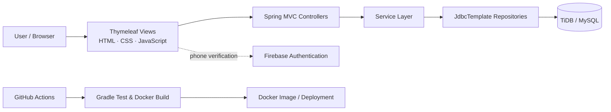

# HomePick — 데이터 기반 맞춤형 부동산 매물 추천 플랫폼

[](https://openjdk.org/)
[](https://spring.io/projects/spring-boot)
[](https://www.thymeleaf.org/)
[](https://www.mysql.com/)
[](https://www.docker.com/)
[](https://github.com/fsclass-n/homepick/actions/workflows/deploy.yml)
[](https://github.com/fsclass-n/homepick)
[](https://github.com/fsclass-n/homepick/issues)
[](LICENSE)

**HomePick**은 부동산 시장 데이터와 사용자의 조건을 연결해, 단순 매물 나열을 넘어 **“왜 이 매물이 지금 나에게 적합한가”**를 설명하는 맞춤형 추천 플랫폼을 지향합니다. 기업 수요와 시장 변화를 반영하는 K-AI 데이터 분석 기반의 비즈니스 플랫폼 구축이 최종 목표입니다.

> **현재 구현 범위:** 회원 온보딩·로그인, Firebase 전화번호 인증 연동 준비, Q&A, TiDB/MySQL 영속화, Docker 배포 및 GitHub Actions CI 기반을 구현했습니다. 매물 수집·시장 분석·추천 모델은 다음 단계의 확장 범위로 명확히 분리합니다.

## Problem & Product Direction

부동산 의사결정은 가격뿐 아니라 지역 수요, 거래 흐름, 생활권, 예산, 입주 시점처럼 함께 고려할 변수가 많습니다. HomePick은 아래의 흐름으로 이를 줄이고자 합니다.

- 사용자 조건을 구조화해 검색·추천의 입력으로 사용
- 시장/매물 데이터를 정제해 비교 가능한 데이터셋으로 축적
- 기업 수요와 지역 지표를 반영한 추천 점수 및 자연어 근거 제공
- Q&A를 통해 계약·대출·실거주 의사결정에 필요한 정보 접근성 향상

## Implemented Features

| 영역 | 구현 내용 | 설계 포인트 |
| --- | --- | --- |
| 회원가입 | 입력값 검증, 중복 ID 방지, BCrypt 해시 저장 | 비밀번호 평문 저장을 방지하고 DB 제약과 애플리케이션 검증을 함께 적용 |
| 로그인 | `HttpSession` 기반 세션 로그인/로그아웃 | 인증 성공 시 최소 사용자 정보를 세션 DTO에 분리 저장 |
| 본인 확인 연동 | Firebase Web 설정을 서버 환경 변수로 주입 | 브라우저 코드에 비밀 설정을 하드코딩하지 않도록 구성 |
| Q&A | JDBC 기반 목록 조회 | Controller → Service → Repository 계층을 분리 |
| 운영 기반 | Docker 멀티 스테이지 빌드, GitHub Actions CI | JDK 21 빌드·테스트와 Docker 이미지 빌드를 자동 검증 |

## Architecture & Data Pipeline

### Current application architecture



### Target data pipeline — recommendation expansion

아래는 현재 웹 MVP 위에 연결할 계획의 데이터 파이프라인입니다. 아직 운영 수집기나 모델을 구현했다고 주장하지 않으며, 구현 우선순위를 공유하기 위한 목표 아키텍처입니다.


## Key Technical Challenges & Solutions

### 1) 개인정보와 인증 상태를 다루는 회원 온보딩

- **문제:** 가입 과정에서 ID 중복, 약한 비밀번호, 잘못된 생년월일·전화번호 형식이 데이터 품질과 보안을 함께 저해할 수 있습니다.
- **해결:** API 레이어에서 형식 검증을 수행하고, `user_id`의 고유 제약 및 `DuplicateKeyException` 처리를 추가했습니다. 비밀번호는 `BCryptPasswordEncoder`로 해시한 뒤 저장합니다.
- **의미:** 향후 추천 프로필·관심 매물 데이터가 추가되어도 사용자 식별자와 도메인 데이터의 연결 기준을 안정적으로 유지할 수 있습니다.

### 2) 외부 인증 설정의 안전한 전달

- **문제:** Firebase 설정과 DB 접속 정보를 소스에 포함하면 유출과 환경 간 설정 불일치 위험이 생깁니다.
- **해결:** Spring 환경 변수 플레이스홀더로 주입하고, Firebase 설정은 필요한 경우에만 View에 전달합니다. `.env.example`로 필요한 키의 형태를 문서화했습니다.
- **의미:** 로컬·CI·배포 환경이 같은 설정 계약을 따르며, 민감 값은 GitHub Secrets 또는 배포 플랫폼 환경 변수로 분리할 수 있습니다.

### 3) 시장 데이터 수집과 30분 단위 동기화 — 확장 설계

- **예상 난관:** 동적 페이지의 봇 차단, 동일 매물의 중복 관측, 수집 지연 및 소스별 스키마 차이입니다.
- **대응 설계:** 공식 API를 우선 사용하고, 허용된 자동화만 수집합니다. Playwright가 필요한 소스는 이미지·폰트·광고 리소스 차단, 헤드리스 실행, 비동기 배치 및 출처별 속도 제한으로 비용을 제어합니다. 원본 스냅샷과 정규화 데이터를 분리하고, `source + external_id + observed_at` 기준 idempotency 키와 가격/상태 변경 이력으로 중복을 처리합니다.
- **운영 원칙:** 재시도 가능한 작업 큐, 수집 시각/출처/파서 버전 로깅, 실패 소스 격리로 데이터 신뢰도를 관리합니다.

### 4) 설명 가능한 맞춤 추천 — 확장 설계

- **입력:** 희망 지역·예산·주거 유형·입주 시점과 가격 추세, 거래량, 교통·생활권, 기업 수요 지표
- **점수화:** 하드 필터(예산/유형) 후 가격 적합도·수요 변화·입지 적합도·사용자 선호도를 가중 합산하고, K-AI 분석 결과를 별도 피처로 결합합니다.
- **추천 이유:** 최종 점수만 노출하지 않고 상위 기여 요인을 근거 문장으로 변환합니다. 예: “예산 대비 가격 적합도가 높고, 최근 거래량이 증가한 권역입니다.”
- **검증:** 오프라인 랭킹 지표와 사용자 저장/문의/클릭 행동을 분리해 측정하고, 지역·가격대별 편향을 점검합니다.

## Tech Stack

| 구분 | 기술 | 사용 목적 |
| --- | --- | --- |
| Backend | Java 21, Spring Boot, Spring MVC, Spring Security | 웹 요청 처리, 입력 검증, 세션 및 비밀번호 해싱 |
| Frontend | Thymeleaf, HTML/CSS, Vanilla JavaScript | 서버 렌더링 기반 화면과 폼 상호작용 |
| Data access | Spring JDBC (`JdbcTemplate`) | SQL을 명시적으로 제어하는 회원/Q&A 영속화 |
| Database | TiDB / MySQL | 관계형 사용자·게시판 데이터 저장 |
| Authentication | Firebase Web Authentication | 전화번호 인증 UI 연동 기반 |
| Infra / CI | Docker, Gradle, GitHub Actions, Render-ready Dockerfile | 재현 가능한 빌드·컨테이너 실행·CI 검증 |
| Planned data & AI | Scheduler, Playwright, data mart, K-AI analytics | 매물 수집·정제·수요 분석·설명형 추천 확장 |

## API Architecture

현재 구현된 주요 엔드포인트입니다.

| Method | Endpoint | Description |
| --- | --- | --- |
| `GET` | `/` | 홈 화면 |
| `GET` | `/member/register` | 회원가입 화면 및 Firebase 설정 전달 |
| `POST` | `/member/register` | 폼 기반 회원가입 |
| `POST` | `/api/members/register` | JSON 기반 회원가입 및 입력 검증 |
| `GET` / `POST` | `/member/login` | 로그인 화면 / 세션 로그인 처리 |
| `GET` | `/member/logout` | 세션 종료 |
| `GET` | `/qna` | Q&A 목록 조회 |
| `GET` | `/health` | 헬스 체크 |

```text
Browser
  └─ Controller                 HTTP / View routing
       ├─ MemberApiController   JSON registration validation
       ├─ LoginController       session login/logout
       ├─ RegisterController    form registration/Firebase config
       └─ QnaController
            └─ Service          business use case boundary
                 └─ Repository  JdbcTemplate + SQL
                      └─ TiDB / MySQL
```

## Directory Structure

```text
homepick/
├─ .github/workflows/deploy.yml       # Gradle CI and Docker build verification
├─ src/main/java/com/onrender/homepick/
│  ├─ config/                         # Spring Security configuration
│  ├─ controller/                     # Web/API request handlers
│  ├─ dto/                            # request, response, session DTOs
│  ├─ repository/                     # JDBC persistence adapters
│  ├─ service/                        # application services
│  └─ HomepickApplication.java
├─ src/main/resources/
│  ├─ static/                         # CSS and JavaScript
│  ├─ templates/                      # Thymeleaf views
│  ├─ application.properties          # application & external configuration
│  └─ schema.sql                      # database schema/reference data
├─ Dockerfile                          # multi-stage JDK/JRE image build
├─ build.gradle
├─ .env.example
└─ README.md
```

## Getting Started

### Prerequisites

- JDK 21
- TiDB Cloud or MySQL-compatible database
- Firebase project configuration for phone authentication (optional for basic server startup)

### 1. Configure environment variables

Create a local `.env` from `.env.example`, then set the values required by `application.properties`.

```dotenv
DB_HOST=your-tidb-host
DB_PORT=4000
DB_DATABASE=homepick_db
DB_USERNAME=your_username
DB_PASSWORD=your_password

FIREBASE_WEB_API_KEY=your_firebase_api_key
FIREBASE_WEB_AUTH_DOMAIN=your-project-id.firebaseapp.com
FIREBASE_WEB_PROJECT_ID=your-project-id
FIREBASE_WEB_STORAGE_BUCKET=your-project-id.appspot.com
FIREBASE_WEB_MESSAGING_SENDER_ID=your_messaging_sender_id
FIREBASE_WEB_APP_ID=your_app_id
```

> `.env.example`의 기존 `TIDB_*` 표기는 인프라 식별용 예시입니다. 애플리케이션 실행에는 위의 `DB_*` 환경 변수명을 사용합니다.

### 2. Prepare database

`src/main/resources/schema.sql`의 테이블 정의를 대상 TiDB/MySQL 데이터베이스에 적용합니다. 운영 환경에서는 마이그레이션 도구(Flyway/Liquibase) 도입을 권장합니다.

### 3. Run locally

PowerShell에서 환경 변수를 설정한 뒤 실행합니다.

```powershell
$env:DB_HOST = 'your-tidb-host'
$env:DB_PORT = '4000'
$env:DB_DATABASE = 'homepick_db'
$env:DB_USERNAME = 'your_username'
$env:DB_PASSWORD = 'your_password'
./gradlew.bat bootRun
```

Open [http://localhost:8080](http://localhost:8080).

### 4. Test and build

```powershell
./gradlew.bat test
./gradlew.bat build
docker build -t homepick:local .
docker run --rm -p 8080:8080 --env-file .env homepick:local
```

## Delivery & Quality Gates

On pushes and pull requests targeting `main`, GitHub Actions:

1. installs Temurin JDK 21;
2. runs the Gradle build and test suite with database secrets injected; and
3. validates that the Dockerfile builds successfully.

This keeps application code and the deployment artifact on the same build contract.

## Roadmap

- [x] Thymeleaf web MVP, account flows, Q&A, JDBC persistence
- [x] Dockerized runtime and GitHub Actions build verification
- [ ] property/listing domain model and migration-based schema management
- [ ] authorized source/API ingestion with 30-minute scheduler and observability
- [ ] normalized market data mart and price history
- [ ] K-AI/market-demand feature pipeline and personalized ranking
- [ ] explanation API, feedback loop, and recommendation quality monitoring

## License

No license has been specified for this repository. Add an explicit license before redistribution or external contribution.
