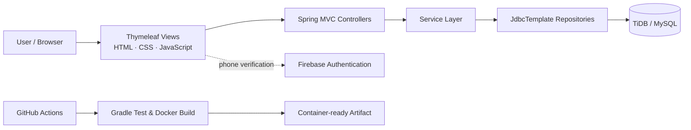
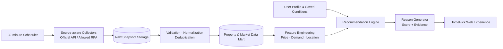

# HomePick — 데이터 기반 맞춤형 부동산 매물 추천 플랫폼

[](https://fsclass-n.github.io/homepick/)
[](https://openjdk.org/)
[](https://spring.io/projects/spring-boot)
[](https://www.thymeleaf.org/)
[](https://www.mysql.com/)
[](https://www.docker.com/)
[](https://github.com/fsclass-n/homepick/actions/workflows/deploy.yml)
[](https://github.com/fsclass-n/homepick)
[](https://github.com/fsclass-n/homepick/issues)
[](#license)

> 부동산 시장 데이터와 사용자 조건을 연결해, 단순 매물 나열을 넘어 **“왜 이 매물이 지금 나에게 적합한가”**를 설명하는 맞춤형 추천 플랫폼입니다.

**[→ 라이브 포트폴리오 보기](https://fsclass-n.github.io/homepick/)**

## Problem & Product Direction

부동산 의사결정은 가격뿐 아니라 지역 수요, 거래 흐름, 생활권, 예산, 입주 시점 등 여러 변수를 함께 비교해야 합니다. HomePick은 다음 흐름으로 이 복잡성을 줄이고자 합니다.

- 사용자 조건을 구조화해 검색·추천의 입력으로 사용
- 시장·매물 데이터를 정제해 비교 가능한 데이터셋으로 축적
- 기업 수요와 지역 지표를 반영한 추천 점수 및 자연어 근거 제공
- Q&A를 통해 계약·대출·실거주 의사결정에 필요한 정보 접근성 향상

| 구분 | 현재 구현 | 확장 설계 |
| --- | --- | --- |
| 웹 서비스 | 회원가입, 로그인/로그아웃, Q&A, Thymeleaf 화면 | 조건 기반 매물 탐색·저장 |
| 데이터 | TiDB/MySQL 영속화, JDBC Repository | 공인 데이터 수집, 정제, 이력 관리 |
| 추천 | 추천 도메인·설명 구조 설계 | 수요 기반 랭킹, 추천 이유 생성, 품질 모니터링 |
| 운영 | Docker 멀티 스테이지 빌드, GitHub Actions 검증 | 스케줄러, 관측성, 재시도 가능한 수집 작업 |

## Architecture & Data Pipeline

### Current application architecture



### Target data pipeline — recommendation expansion

> 아래는 아직 운영 수집기나 추천 모델을 구현했다고 주장하지 않는 **목표 아키텍처**입니다. 구현 우선순위와 데이터 신뢰성 전략을 공유합니다.



## Key Technical Challenges & Solutions

### 1) 개인정보와 인증 상태를 다루는 회원 온보딩

**Challenge** — 중복 ID, 약한 비밀번호, 잘못된 생년월일·전화번호 형식은 데이터 품질과 보안을 함께 저해합니다.

**Solution** — API 레이어에서 형식 검증을 수행하고 `user_id` 고유 제약과 `DuplicateKeyException` 처리를 적용했습니다. 비밀번호는 `BCryptPasswordEncoder`로 해시하며, 인증 후 필요한 최소 사용자 정보만 Session DTO로 분리합니다.

**Impact** — 추천 프로필·관심 매물이 추가되어도 사용자 식별자와 도메인 데이터를 안정적으로 연결할 수 있습니다.

### 2) 외부 인증 설정의 안전한 전달

**Challenge** — Firebase 및 DB 연결 정보를 코드에 포함하면 유출 위험과 환경별 설정 불일치가 발생합니다.

**Solution** — Spring 환경 변수 플레이스홀더로 설정을 주입하고, Firebase 설정은 필요한 View에만 전달합니다. `.env.example`로 설정 계약을 문서화했습니다.

**Impact** — 로컬·CI·배포 환경이 같은 구성 계약을 따르고, 민감값은 GitHub Secrets 또는 배포 플랫폼의 환경 변수로 분리됩니다.

### 3) 30분 단위 시장 데이터 동기화와 정제 — 확장 설계

**Challenge** — 동적 소스의 차단 정책, 수집 지연, 동일 매물의 중복 관측, 소스별 스키마 차이가 예상됩니다.

**Solution** — 공식 API를 우선 사용하고, 허가된 자동화가 필요한 경우에만 브라우저 기반 수집을 적용합니다. Playwright 수집은 이미지·폰트·광고 리소스 차단, 헤드리스 실행, 비동기 배치, 출처별 속도 제한으로 비용을 제어합니다. `source + external_id + observed_at` idempotency 키, 원본 스냅샷과 정규화 데이터 분리, 가격·상태 이력으로 중복과 재처리를 관리합니다.

**Impact** — 추천 모델 이전에 입력 데이터의 신뢰성을 확보합니다. 수집 시각·출처·파서 버전 로깅, 실패 소스 격리, 재시도 가능한 작업 큐를 운영 기준으로 둡니다.

### 4) 설명 가능한 맞춤 추천 — 확장 설계

**Challenge** — 높은 점수만 보여주는 추천은 사용자가 선택을 신뢰하기 어렵고, 지역·가격대별 편향을 발견하기도 어렵습니다.

**Solution** — 예산·주거 유형 하드 필터 이후 가격 적합도, 수요 변화, 입지 적합도, 사용자 선호도를 가중 합산합니다. K-AI 분석 결과는 별도 피처로 결합하고, 상위 기여 요인을 자연어 근거로 변환합니다.

**Impact** — “예산 대비 가격 적합도가 높고 최근 거래량이 증가한 권역입니다”처럼 결과의 이유를 전달합니다. 저장·문의·클릭 이벤트와 오프라인 랭킹 지표를 분리해 품질을 검증할 수 있습니다.

## Tech Stack

| 영역 | 기술 | 역할 |
| --- | --- | --- |
| Backend | Java 21, Spring Boot, Spring MVC, Spring Security | 요청 처리, 입력 검증, 세션·비밀번호 보안 |
| Frontend | Thymeleaf, HTML/CSS, Vanilla JavaScript | 서버 렌더링 기반 화면과 폼 상호작용 |
| Data Access | Spring JDBC (`JdbcTemplate`) | 명시적 SQL 제어 기반 회원·Q&A 영속화 |
| Database | TiDB / MySQL | 관계형 사용자·게시판 데이터 관리 |
| Authentication | Firebase Web Authentication | 전화번호 인증 UI 연동 기반 |
| Infra / CI | Docker, Gradle, GitHub Actions | 재현 가능한 빌드·컨테이너 실행·자동 검증 |
| Planned Data & AI | Scheduler, Official API, permitted Playwright, data mart, K-AI analytics | 수집·정제·수요 분석·설명형 추천 확장 |

## API Architecture

| Method | Endpoint | Responsibility |
| --- | --- | --- |
| `GET` | `/` | 홈 화면 렌더링 |
| `GET` | `/member/register` | 회원가입 화면 및 Firebase 설정 전달 |
| `POST` | `/member/register` | 폼 기반 회원가입 |
| `POST` | `/api/members/register` | JSON 기반 회원가입·입력 검증 |
| `GET` / `POST` | `/member/login` | 로그인 화면·세션 로그인 처리 |
| `GET` | `/member/logout` | 세션 종료 |
| `GET` | `/qna` | Q&A 목록 조회 |
| `GET` | `/health` | 헬스 체크 |

```text
Browser
  └─ Controller                 HTTP / View routing
       ├─ MemberApiController   JSON registration validation
       ├─ LoginController       session login/logout
       ├─ RegisterController    form registration/Firebase config
       └─ QnaController
            └─ Service          business use case boundary
                 └─ Repository  JdbcTemplate + SQL
                      └─ TiDB / MySQL
```

## Directory Structure

```text
homepick/
├─ .github/workflows/deploy.yml       # Gradle CI and Docker build verification
├─ src/main/java/com/onrender/homepick/
│  ├─ config/                         # Spring Security configuration
│  ├─ controller/                     # Web/API request handlers
│  ├─ dto/                            # request, response, session DTOs
│  ├─ repository/                     # JDBC persistence adapters
│  ├─ service/                        # application services
│  └─ HomepickApplication.java
├─ src/main/resources/
│  ├─ static/                         # CSS and JavaScript
│  ├─ templates/                      # Thymeleaf views
│  ├─ application.properties          # application & external configuration
│  └─ schema.sql                      # database schema/reference data
├─ index.html                          # GitHub Pages portfolio
├─ Dockerfile                          # multi-stage JDK/JRE image build
├─ build.gradle
├─ .env.example
└─ README.md
```

## Getting Started

### Prerequisites

- JDK 21
- TiDB Cloud 또는 MySQL 호환 데이터베이스
- Firebase 프로젝트 설정 (전화번호 인증 UI 연동 시)

```powershell
$env:DB_HOST = 'your-tidb-host'
$env:DB_PORT = '4000'
$env:DB_DATABASE = 'homepick_db'
$env:DB_USERNAME = 'your_username'
$env:DB_PASSWORD = 'your_password'
./gradlew.bat bootRun
```

```powershell
./gradlew.bat test
./gradlew.bat build
docker build -t homepick:local .
```

## Roadmap

- [x] Thymeleaf 웹 MVP, 회원 온보딩, 로그인, Q&A, JDBC 영속화
- [x] Dockerized runtime 및 GitHub Actions 빌드 검증
- [ ] 매물 도메인 모델과 migration 기반 스키마 관리
- [ ] 승인된 출처/API 수집 및 30분 주기 동기화·관측성
- [ ] 정규화된 시장 데이터 마트와 가격 이력
- [ ] K-AI/시장 수요 피처 파이프라인과 개인화 랭킹
- [ ] 추천 근거 API, 피드백 루프, 추천 품질 모니터링

## License

현재 별도의 라이선스가 지정되지 않았습니다. 외부 재배포 또는 기여를 받기 전 명시적인 라이선스 정책을 추가할 예정입니다.
